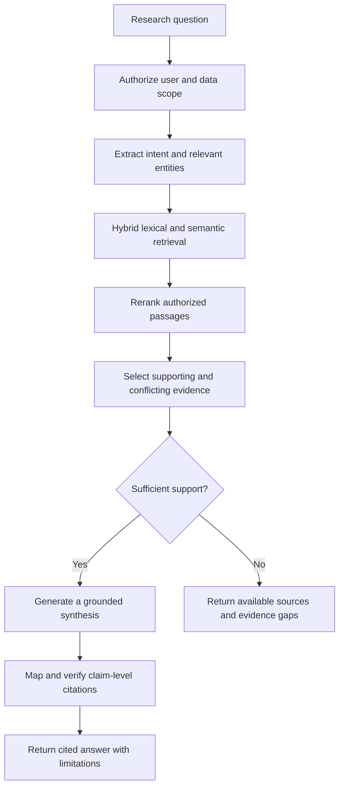

<div align="center">


<h1>SAKSHYA</h1>

<p><strong>An AI-enabled national research, geospatial intelligence and policy experimentation platform for evidence-based land governance.</strong></p>


<br/><br/>

**[Overview](#overview) · [Architecture](#system-architecture) · [Features](#key-features) · [Intelligence](#intelligence-layer) · [Evidence](#evidence-first-ai) · [Math](#mathematical-formulations) · [Stack](#technology-stack) · [Team](#team)**

</div>

> Sakshya brings research, policy and geographic evidence into one governed workflow. Its purpose is to help institutions discover knowledge, compare alternatives and publish findings that experts can trace, challenge and review.

**Current status:** Architecture and documentation. Application source, trained-model releases and deployment configuration are not present in the inspected workspace. Platform capabilities and technologies below describe the **proposed system**; they are not deployment or performance claims. [View implementation status](docs/implementation-status.md).

---

## 📑 Table of Contents

<details open>
<summary><b>Expand / collapse</b></summary>

1. [Project Card](#project-card)
2. [Overview](#overview)
3. [Why Sakshya](#why-sakshya)
4. [Key Features](#key-features)
5. [Use Cases](#use-cases)
6. [System Architecture](#system-architecture)
7. [Intelligence Layer](#intelligence-layer)
8. [Research Intelligence Pipeline](#research-intelligence-pipeline)
9. [Evidence-First AI](#evidence-first-ai)
10. [Decision and Evidence Service](#decision-and-evidence-service)
11. [Core Mathematical Formulations](#mathematical-formulations)
12. [Technology Stack](#technology-stack)
13. [Internal Data Contracts](#internal-data-contracts)
14. [Storage, Security and Resilience](#security-and-data-governance)
15. [AI/ML Lifecycle and Evaluation](#evaluation-and-reliability)
16. [Feasibility and Viability](#feasibility-and-viability)
17. [Operating and Sustainability Model](#operating-model)
18. [Impact and Benefits](#impact-and-benefits)
19. [Comparative Positioning](#comparative-positioning)
20. [Research and References](#research-and-references)
21. [User Roles](#user-roles)
22. [Architectural Boundary and Principles](#architectural-boundary)
23. [Roadmap](#roadmap)
24. [Getting Started and Documentation](#quick-start)
25. [FAQ](#faq)
26. [Team](#team)
27. [Contributing and License](#contributing)

</details>

---

<a id="project-card"></a>

## 🪪 Project Card

| Field | Details |
|---|---|
| **Project** | SAKSHYA — AI-Enabled Land Governance Research and Policy Innovation |
| **Platform focus** | National Digital Platform for Research and Policy Innovation |
| **Domain** | Land governance, research, geospatial analysis and policy experimentation |
| **Category** | Software |
| **Team** | Wannacry |
| **Team ID** | `133474` |
| **Current stage** | Architecture and documentation |
| **Primary output** | Traceable, evidence-backed analysis and policy alternatives for expert review |
| **Integration boundary** | Authorized source systems retain authority over their records |

---

<a id="overview"></a>

## 📌 Overview

Land governance depends on evidence that rarely lives in one place. Administrative records, legal documents, research publications, cadastral maps, satellite observations and socio-economic indicators differ in format, jurisdiction, publication date and access conditions. Finding a document is only the beginning: a researcher must also establish whether it is current, relevant to the region and suitable for the question.

Sakshya proposes an intelligence, research, analytics and collaboration layer above these sources. It brings their metadata, permitted content and analytical derivatives into a common evidence workflow while preserving source authority and access restrictions.

The intended users include researchers, policymakers, government agencies, academic institutions, land administrators, domain experts and public users with appropriate permissions. National coverage is a design ambition; access to each external source requires its own authorization and integration work.

**Sakshya does not replace authoritative land-record systems, determine ownership or make government policy decisions.** It supports discovery, analysis and expert review through governed connectors to authorized systems.

### Three intelligence pillars

| 📚 Research intelligence | 🗺️ Geospatial intelligence | ⚖️ Policy experimentation |
|---|---|---|
| Discover documents through hybrid retrieval, connect findings and prepare cited research syntheses. | Examine land-use patterns, climate exposure and infrastructure through spatial analysis and validated imagery methods. | Compare policy alternatives and scenarios using explicit applicability, assumptions and uncertainty. |

### A shared foundation

| 🔗 Versioned knowledge | 🧾 Evidence trace | 👥 Institutional collaboration |
|---|---|---|
| Source records, metadata, maps and documents retain their identity, permissions and history. | Findings preserve source anchors, analytical versions and reviewer decisions. | Scoped workspaces connect researchers, stewards and reviewers around common evidence. |

---

<a id="why-sakshya"></a>

## 🎯 Why Sakshya

| Research and governance challenge | Sakshya's proposed response |
|---|---|
| Evidence is scattered across institutions and formats | A governed catalog linking policies, studies, legal material and spatial datasets. |
| Search results lack local or historical context | Retrieval that carries jurisdiction, observation period and source version. |
| Map layers and literature are analyzed separately | Shared geographic and temporal scope across research and geospatial work. |
| AI answers hide weak or conflicting support | Claim-level citations, contradiction visibility and explicit evidence gaps. |
| A policy ranking can obscure applicability | Eligibility checks before comparison; unknown conditions remain open for review. |
| Research outputs lose their link to field outcomes | Shared briefs, pilot milestones and reviewed outcomes that re-enter the evidence workflow. |
| Publication permissions change over time | Consistent access checks across catalog entries, AI context, maps and exports. |

### 💡 What distinguishes the design

**Context before ranking.** Policy options must fit the jurisdiction, effective period and documented constraints before comparison. **Evidence alongside every finding.** A utility score, evidence quality and predictive uncertainty remain separate. **Publication under institutional control.** Administrators and stewards govern resources while reviewers assess consequential outputs.

---

<a id="key-features"></a>

## ✨ Key Features

These are **planned capabilities**. No runtime implementation is verified in this repository.

| Capability | Intended use |
|---|---|
| Unified knowledge repository | Discover research, policies, legal documents, datasets and case studies through a versioned catalog. |
| Research intelligence | Retrieve relevant passages, compare findings and prepare cited literature syntheses. |
| Geospatial intelligence | Examine land-use patterns, imagery, climate exposure and infrastructure in a common geographic context. |
| Policy experimentation | Compare baselines and scenarios while exposing assumptions, uncertainty and implementation constraints. |
| Evidence trace | Follow a claim back to its sources, transformations, analytical method and review history. |
| Collaborative workspaces | Share scoped resources, annotate source versions and develop research briefs across institutions. |
| Dashboards and policy explorer | Explore approved indicators, policy alternatives, research outputs and project outcomes. |
| Research and pilot workflows | Connect institutional proposals, grants and pilot milestones with documented evidence and outcomes. |
| Integration layer | Exchange permitted data and artifacts with external systems through governed connectors and APIs. |

---

<a id="use-cases"></a>

## 🌐 Use Cases

| | Land-use planning | Climate resilience | Policy research and pilots |
|---|---|---|---|
| **Question** | Which land-use options fit the selected region and its constraints? | Where do exposure and evidence gaps affect intervention choices? | How can a research finding become a reviewable pilot proposal? |
| **Inputs** | Permitted records, policies, research and spatial layers. | Climate, land-use, infrastructure and socio-economic layers. | Studies, policy context, baseline indicators and programme information. |
| **Workflow** | Regional catalog → GIS overlays → cited synthesis → alternative comparison. | Scope alignment → risk overlays → scenario assumptions → sensitivity analysis. | Shared brief → expert review → grant/pilot milestones → outcome collection. |
| **Output** | Applicable alternatives with evidence, trade-offs and limitations. | Regional comparisons with assumptions, coverage and uncertainty. | A reviewed brief and versioned pilot evidence for subsequent research. |

These are intended workflows. They do not assert that a regional dataset, pilot or institutional integration is already operational.

---

<a id="system-architecture"></a>

## System Architecture


The supplied diagram is a conceptual view of the data, analysis and user-service planes. The sequence below defines the execution boundaries: ingestion must pass validation and permission checks before publication, and consequential policy artifacts must pass human review before release. Connectors in the illustration do not authorize a bypass of either gate.

1. **National data sources supply permitted inputs.** Candidate inputs include land records, policies, research, legal and court/dispute material, cadastral data, GIS layers, satellite imagery, remote sensing, climate information, census and socio-economic indicators, infrastructure, surveys, institutional studies, case studies and programme/project data. Source licensing, authorization and governance requirements determine what may be ingested, retained, analyzed or shared.
2. **Ingestion establishes quality and provenance.** Approved APIs, ETL pipelines, controlled uploads and document/GIS connectors capture original inputs. Processing includes OCR where needed, metadata extraction, schema and coordinate reference system (CRS) validation, deduplication, data classification and lineage recording. Invalid or uncertain inputs remain quarantined for steward review and correction.
3. **A validation and permission gate controls publication.** Accepted inputs become versioned resources with an approved audience and permitted uses. The knowledge layer separates structured metadata and spatial features from immutable original files, retrieval indexes and logical relationships among policies, places, studies, indicators and datasets.
4. **The authorized analysis orchestrator defines the work.** It validates the requesting user's scope, verifies access to inputs, selects allowed tools, pins dataset and model versions and dispatches reproducible jobs. Execution records connect inputs, parameters, transformations and outputs.
5. **Specialized modules analyze different evidence types.** Research intelligence processes documents, geospatial intelligence processes spatial data and imagery, and policy experimentation evaluates indicators and scenarios. Each module uses methods appropriate to its data and task.
6. **Evidence fusion assembles an attributable assessment.** Results retain their source versions, geographic and temporal scope, assumptions, transformations and uncertainty. Supporting and conflicting evidence remain distinguishable.
7. **The decision and evidence service prepares a reviewable artifact.** It checks applicability, compares alternatives and assembles citations, score components where appropriate, analytical results and limitations. Experts may approve, reject, challenge or request revision. Revised results return through review.
8. **Approved artifacts reach permitted audiences.** Dashboards, cited answers, research briefs, reports and API outputs expose the authorized result. Observed pilot outcomes re-enter ingestion and quality review before becoming new evidence.

The **supporting user-service plane** connects users and channels to an identity/API gateway and portal application services. It handles research workspaces, catalog browsing, policy exploration and other interactive experiences. Ordinary authorized reads do not require an AI or simulation job. Analytical requests enter the orchestrator; identity services do not consume the knowledge store as an analytical stage.

Access control, provenance, audit, model validation, monitoring, reproducibility, version control and recovery apply across both planes. Detailed boundaries and failure behavior are documented in [Architecture and Execution Contracts](docs/architecture.md).

<details>
<summary><b>📖 Expand the layer specification</b></summary>

| Layer | Responsibility | Handoff condition |
|---|---|---|
| National data sources | Supply permitted records, research, imagery and contextual datasets. | Source identity, access terms and intended use are recorded. |
| Ingestion and quality | Extract, normalize, validate and classify incoming content. | Failed or uncertain records remain quarantined. |
| Validation / permission gate | Resolve quality findings and authorize resource publication. | A steward-approved source version and audience are defined. |
| Unified knowledge and data services | Maintain catalog, spatial records, objects, indexes and relationships. | Retrieval exposes only authorized resource versions. |
| Authorized analysis orchestrator | Check scope, pin inputs and dispatch allowed analytical tools. | A reproducible job manifest accompanies every run. |
| Intelligence modules | Execute research, geospatial or policy analysis. | Findings retain methods, limitations and input references. |
| Evidence fusion | Align complementary and conflicting evidence. | Scope, units and provenance remain inspectable. |
| Decision and evidence service | Check applicability and prepare comparisons and evidence packets. | Missing components and uncertainty are visible. |
| Human review | Approve, reject, challenge or request revision. | Review outcome and rationale are recorded. |
| Delivery | Serve approved outputs through portals, reports and scoped APIs. | Audience permissions are checked at delivery time. |
| Cross-cutting governance | Apply identity, access, lineage, audit, monitoring and recovery. | Controls cover ingestion, analysis and delivery. |

</details>

### Example end-to-end research task

A planning team asks which interventions merit further study in a selected region. A steward first publishes permitted policy documents and compatible spatial layers. The orchestrator fixes the region, period and resource versions, then requests relevant literature and spatial indicators. The policy module checks applicability and compares eligible alternatives under stated assumptions. Evidence fusion preserves agreement, disagreement and gaps. Reviewers inspect the resulting brief before authorizing its audience and release.

This example describes a workflow, not an observed result. A missing legal condition, inaccessible dataset or unsupported claim should limit the output rather than silently disappear from it.

---

<a id="intelligence-layer"></a>

## 🧠 Intelligence Layer

### Research Intelligence

The research subsystem is designed for evidence discovery and document analysis. A proposed pipeline combines lexical search and semantic embeddings, then reranks candidate passages within the authorized corpus. NLP and named entity recognition can identify jurisdictions, policies, institutions, dates and other domain entities, with review for uncertain extraction.

Retrieved evidence provides the context for RAG and LLM-assisted synthesis. Planned outputs include cited answers, literature summaries, relevant-resource recommendations, contradiction discovery and research-gap suggestions. An apparent gap in the accessible corpus must not be presented as proof that no research exists.

Source versions and citation anchors travel with each passage. Conflicting findings should remain visible, and insufficient support should produce a bounded answer with missing evidence clearly identified.

### Geospatial Intelligence

The geospatial layer is designed to support spatial queries and visualization alongside land-use classification, remote-sensing analysis, change detection, climate-risk and infrastructure overlays, spatial statistics, tiles and vulnerability analysis.

CNN, Vision Transformer and segmentation modules are architectural options for imagery tasks. Their inclusion in a diagram does not establish that models have been trained or validated. Evaluation must account for geography, acquisition period, sensor, resolution and label quality. Layers require compatible coordinate systems, boundaries, observation periods and units before comparison.

**Image-derived land cover is not evidence of legal ownership.** Spatial findings must retain the source resolution, coverage and uncertainty needed to interpret them correctly.

### Policy Experimentation

Policy experimentation is analytical decision support. The platform is designed to surface relevant alternatives, supporting and conflicting evidence, indicators, assumptions and scenario outcomes for expert review.

| Analytical mode | Question it supports | Required interpretation |
|---|---|---|
| Descriptive | What changed within the selected region and period? | Observed values with definitions, units, coverage and sources. |
| Predictive | What may happen under the model? | Backtested forecasts with assumptions and evaluated uncertainty. |
| Scenario | How do alternatives compare with a baseline? | Compatible inputs, explicit parameter changes and sensitivity analysis. |
| Causal | What effect can be attributed to an intervention? | A defensible identification strategy, suitable comparison data and robustness checks. |

Monte Carlo methods can explore specified input uncertainty. They cannot compensate for missing evidence or unsupported causal assumptions. Numerical findings should come from validated analytical tools; language models may explain those findings with their limits intact.

### Evidence Fusion

Evidence fusion combines research findings, spatial observations, statistical outputs and policy context into a common assessment. It does not erase disagreement or average incompatible signals into a single confidence number.

Each contribution should retain its source, document or dataset version, model and method, transformations, geographic and temporal scope, assumptions, uncertainty and reviewer status. Comparisons require compatible units and denominators. Evidence from another region may inform an analysis while still requiring an explicit transferability assessment.

---

<a id="research-intelligence-pipeline"></a>

## 🔎 Research Intelligence Pipeline

The following is a **conceptual workflow**, not an implemented API contract.



Retrieved documents are untrusted input to the model. Document text must not change tool permissions, reveal restricted context or override the user's authorized scope. Output checks should verify both citation existence and whether the cited material supports the claim.

---

<a id="evidence-first-ai"></a>

## 🧾 Evidence-First AI

An important AI-assisted finding should be traceable through:

**Finding → supporting and conflicting sources → source versions → geography and period → method/model → assumptions → evidence quality and uncertainty → reviewer decision.**

The intended evidence record includes:

| Field | What it establishes |
|---|---|
| Claim and source anchors | The exact assertion and the passages, observations or features used to support or challenge it. |
| Resource versions | Which document, dataset, boundary and policy versions were available to the analysis. |
| Geographic and temporal scope | Where and when the finding applies, including coverage gaps. |
| Run provenance | The analytical method, model, prompt and code versions, parameters and transformations. |
| Assumptions and limitations | Conditions required for interpretation and known limits on transferability. |
| Evidence quality and uncertainty | Appraisal of supporting material, missing factors and validated uncertainty estimates where available. |
| Review history | Approval, rejection, challenge or revision, with a responsible reviewer and rationale. |

**Illustrative claim, not an observed result:** “Built-up land increased within the selected region.”

Such a claim would need compatible satellite observations and a validated change layer, a fixed geographic boundary, an observation period, data and model versions, and the method used to calculate change. Relevant research and infrastructure data may add context but do not independently prove the change. Reviewers would need to inspect classification errors and coverage limitations before approving the interpretation. No measured finding is asserted here.

---

<a id="decision-and-evidence-service"></a>

## ⚖️ Decision and Evidence Service

The decision service turns attributable analysis into an artifact that an expert can assess. Its design separates five responsibilities:

1. **Check applicability.** Evaluate jurisdiction, effective dates and documented conditions. Mark unknown applicability for review. A high ranking score cannot make an ineligible policy applicable.
2. **Assemble evidence.** Preserve supporting and contradictory findings, their quality and their relevance to the current region and objective.
3. **Compare alternatives.** Use a documented rubric where scoring is appropriate, with visible components, weights and missing values. Compare scenario outcomes under compatible assumptions.
4. **Communicate limits.** Distinguish utility ranking, evidence coverage, evidence quality and prediction uncertainty. Do not label a preference-weighted score as the probability of policy success.
5. **Prepare and review artifacts.** Attach claim-level citations, input/model versions, scenario results and reviewer decisions to the brief, report or dashboard output.

The design materials propose contextual fit, evidence strength, feasibility, cost fit and environmental/social alignment as possible scoring dimensions. Any weights require domain approval and sensitivity testing. Missing required components should produce an incomplete assessment rather than silent imputation or reweighting.

Human review may approve, reject, challenge or request revision. Publication also requires an audience and permission check: analytical approval alone does not make restricted evidence public. Feedback and pilot outcomes enter a reviewed evidence workflow; they do not automatically retrain models or change scoring rules.

---

<a id="mathematical-formulations"></a>

## 🧮 Core Mathematical Formulations

The presentation proposes the following transparent formulations. They are **design examples**, not validated scoring models or reported performance results.

### 1 · Policy applicability gate

$$
A = J \times V \times K
$$

Here $J$, $V$ and $K$ represent confirmed jurisdictional applicability, temporal validity and satisfaction of required constraints. Each confirmed test is binary. Only $A=1$ proceeds to ranking; a failed condition excludes the option. **An unknown condition stays unresolved** and requires review rather than being treated as a pass.

### 2 · Transparent policy ranking

$$
S = 0.25C + 0.25E + 0.20F + 0.15K_c + 0.15I
$$

| Term | Proposed criterion | Scale |
|---|---|---|
| $C$ | Fit to regional context and objectives | 0–100 |
| $E$ | Strength and relevance of supporting evidence | 0–100 |
| $F$ | Implementation feasibility | 0–100 |
| $K_c$ | Cost suitability under the stated resource constraints | 0–100 |
| $I$ | Environmental and social alignment | 0–100 |

The presentation's weights are illustrative and sum to one. Domain reviewers must define the rubrics, approve weights and examine sensitivity. Missing required inputs produce an incomplete assessment. **$S$ is a preference-weighted utility score, not the probability of policy success**; evidence quality and uncertainty must also be shown independently.

### 3 · Evidence coverage

$$
\mathrm{Coverage} = \frac{N_{\mathrm{supported\ material\ claims}}}{N_{\mathrm{material\ claims}}}
$$

A claim counts as supported only after checking that its cited source supports the assertion within the stated scope. Coverage does not measure source quality or establish correctness. Report it as undefined when there are no material claims.

### 4 · Scenario comparison

$$
\Delta I = I_{\mathrm{scenario}} - I_{\mathrm{baseline}}
$$

Hold geography, horizon, indicator definitions and units constant. Record parameter changes and examine sensitivity. A scenario difference is a modeled comparison; it is not automatically a causal effect.

### 5 · Land-use segmentation evaluation

$$
\mathrm{IoU}_c = \frac{|P_c \cap G_c|}{|P_c \cup G_c|}
$$

$P_c$ is the predicted region for class $c$ and $G_c$ is the labeled reference. Evaluate on held-out imagery and report the protocol by class, geography and period, including how absent classes are handled. No segmentation accuracy is claimed here.

---

<a id="technology-stack"></a>

## 🧰 Technology Stack

**Verified application stack: none yet.** No application manifests or source modules are present in the inspected repository. Markdown documentation and diagram assets are available; the table below records proposed technology choices from the design materials, not installed dependencies.

| Layer | Proposed technologies or approach | Responsibility |
|---|---|---|
| Portal | React, TypeScript, MapLibre | Research workspaces, interactive maps, dashboards and permitted public views. |
| Application services | Python, FastAPI | Catalog operations, authorization-aware application workflows and integration interfaces. |
| Background processing | Celery, RabbitMQ | Ingestion and analytical jobs, bounded retries and failure handling. |
| Structured and spatial data | PostgreSQL, PostGIS | Resource metadata, source versions, workflows, spatial features and queries. |
| Retrieval | PostgreSQL full-text search, pgvector, reranking | Lexical and semantic discovery within authorized resources. |
| Object storage | S3-compatible object storage | Original files, imagery, datasets and versioned analytical artifacts. |
| Document intelligence | Transformer-based retrieval and synthesis, NLP/NER | Evidence selection, extraction, citation-grounded answers and literature analysis. |
| Imagery intelligence | PyTorch-based CNN/ViT or segmentation models | Validated imagery analysis and land-use change workflows. |
| Identity and observability | OIDC, scoped roles and attributes, privileged MFA, audit records | Proposed access and operational controls; provider selection and configuration remain implementation work. |

Knowledge relationships are a **logical relationship layer** among policies, locations, studies, indicators and datasets. A dedicated graph database is not established by this repository. Likewise, no separate search cluster, container deployment, CI pipeline or operational identity provider is verified.

---

<a id="internal-data-contracts"></a>

## 📦 Internal Data Contracts

The architecture calls for the following **logical records**. Field names, schemas and API endpoints remain implementation work.

| Record | Minimum information | Why it matters |
|---|---|---|
| Resource version | Source identity, original object reference, checksum, version, license/permissions, geography, period and quality status. | Establishes exactly what may be used and cited. |
| Citation anchor | Resource version, page/passage or feature/observation reference, extraction method and access scope. | Connects a claim to inspectable evidence. |
| Analysis manifest | Request scope, input and model versions, code/prompt versions, parameters, boundaries and execution status. | Supports reproducibility and failure diagnosis. |
| Evidence item | Finding, method, sources, units, scope, assumptions and uncertainty. | Preserves interpretation across analytical modules. |
| Policy assessment | Applicability status, rubric version, score components, missing inputs and scenario references. | Keeps eligibility and comparison distinct. |
| Review decision | Reviewer, artifact version, decision, rationale and requested changes. | Preserves responsibility and revision history. |
| Published artifact | Approved content version, intended audience, source lineage and withdrawal state. | Supports controlled delivery and downstream correction. |

<details>
<summary><b>Contract and execution rules</b></summary>

- A new source revision receives a new identity; it must not silently overwrite evidence used by an earlier run.
- Retries must not duplicate resource releases, review decisions or published artifacts.
- Permission changes require rechecking pending jobs and dependent outputs before delivery.
- Generated answers, map tiles, embeddings and exports remain subject to source permissions.
- Model outputs carry status and failure information; missing results cannot be interpreted as zero impact.
- Long-running analyses use bounded jobs with explicit failure and cancellation handling.

See [Architecture and Execution Contracts](docs/architecture.md) for the detailed boundaries.

</details>

---

<a id="security-and-data-governance"></a>

## 🔐 Storage, Security and Resilience

The following are **design requirements**, not claims of deployed controls.

| Boundary | Required behavior |
|---|---|
| Identity and authorization | Verify identity and evaluate role, organization, project, resource and action scope. Require stronger authentication for privileged actions. |
| Source access | Record licensing, permitted audience, retention conditions and allowed analytical/model use before accepting content. |
| Ingestion | Quarantine untrusted files, validate content and metadata, and escalate uncertain extraction or classification to a steward. |
| Retrieval and model context | Filter authorized resources before retrieval and synthesis. Keep credentials server-side and restrict model/tool routes to approved uses. |
| Publication and withdrawal | Apply visibility changes to documents, indexes, embeddings, maps, caches and generated artifacts. Recheck access before delivery. |
| Jobs and data movement | Use scoped workload identities, constrained analytical tools and approved storage/model destinations. Avoid sensitive payloads in queue messages. |
| Audit and operational logs | Record access, transformations and review decisions without copying restricted source content into general-purpose telemetry. |
| Recovery | Preserve consistent catalog/object references, bound retries and verify restoration before relying on operational recovery claims. |

No dedicated vulnerability-reporting channel or deployed security assessment is documented yet. Do not place credentials, restricted records or personal data in public examples or issue discussions.

---

<a id="evaluation-and-reliability"></a>

## 🤖 AI/ML Lifecycle and Evaluation

### Proposed model lifecycle

**Define the task → approve data use → curate evaluation examples → pin a candidate model → evaluate by task and region → expert review → controlled release → monitor → revise or roll back.**

Research retrieval, language generation, imagery analysis and forecasting need separate evaluation protocols. An updated model, embedding method or rubric creates a new version; dependent indexes and saved runs must record the transition. Reviewer feedback is a candidate for curated improvement, not an automatic training signal.

### Evaluation requirements

Evaluation should establish what works for a defined corpus, region and task before broader claims are made. Proposed acceptance checks include:

| Area | Evidence required |
|---|---|
| Retrieval and synthesis | Expert-labeled questions, relevance assessment, claim support, citation correctness and behavior when evidence is insufficient. |
| Spatial analysis | Geometry/CRS checks, held-out labels and error analysis by geography, time, sensor and class. |
| Policy assessment | Expert agreement on applicability, documented rubric inputs, missing-data handling and sensitivity to alternative priorities. |
| Access isolation | Cross-organization denial cases, withdrawn-source retrieval checks and permission changes during a running job. |
| Reproducibility | Reconstruction from pinned inputs and recorded versions, including explicit limits for nondeterministic models. |
| Operations | Duplicate-event handling, bounded retry behavior, worker-failure recovery and restoration exercises. |
| User value | Baseline comparisons for evidence-finding time, task completion, review effort and decision traceability. |

These are evaluation plans. No benchmark results, model accuracy, measured savings, uptime or adoption figures are reported by this repository.

---

<a id="feasibility-and-viability"></a>

## 🧪 Feasibility and Viability

### Technical feasibility

| Design choice | Practical starting point |
|---|---|
| Established components | Build catalog, spatial storage and portal workflows around the proposed PostgreSQL, PostGIS, Python and React stack. |
| Focused data scope | Begin with approved documents, one region and a small, reviewed indicator set. |
| Bounded AI tasks | Start with retrieval and cited synthesis; assess support quality before adding complex imagery or causal work. |
| Modular implementation | Keep catalog, permissions, collaboration, GIS and analytical jobs behind clear contracts. |
| Measurable acceptance | Compare evidence-finding time, citation correctness and research task completion against a recorded baseline. |

### Challenges and mitigation

| Challenge | Proposed response |
|---|---|
| Inconsistent sources and OCR | Source-specific validation, quarantine and steward review. |
| Changing access conditions | Permission checks across retrieval, jobs, indexes, maps and exports; withdrawal propagation. |
| Unsupported synthesis | Evidence selection, citation verification, visible gaps and bounded answers. |
| Regional bias and drift | Evaluation by region, time and source, with expert-reviewed labels and rollback options. |
| Expensive analytical jobs | Quotas, bounded retries, approved-result caching and task-specific compute. |
| Low adoption or unclear ownership | Co-design one institutional workflow and assign a sponsor, stewards, reviewers and operator. |

---

<a id="operating-model"></a>

## 💼 Operating and Sustainability Model

The proposed operating model is institutional. Funding, service commitments and hosting arrangements remain to be agreed with participating organizations.

| Area | Proposed approach |
|---|---|
| Stakeholders | Platform sponsor, government departments, research institutions, universities, reviewers and permitted users. |
| Resourcing | Institutional operating support, research/pilot programmes, and integration and training budgets. |
| Cost drivers | Storage, compute, source curation, security, integration, user support and model evaluation. |
| Hosting decision | Choose the operating environment through institutional requirements and approved data-access arrangements. |
| Adoption | Co-design one regional pilot, train institutional champions and reuse approved methods and briefs. |
| Accountability | Source stewards own quality and access; reviewers assess evidence and publication; operators own service reliability and recovery. |
| Measurement | Establish baselines for evidence-finding time, citation quality, task completion, reviewer effort and cost per workflow. |

No pricing, revenue, procurement agreement or deployment cost is asserted. Estimates should follow a measured pilot workload and a documented service scope.

---

<a id="impact-and-benefits"></a>

## 🌍 Impact and Benefits

| Audience | Intended benefit | How to assess it |
|---|---|---|
| Government and policymakers | Find relevant studies and compare regional evidence and policy alternatives. | Evidence-finding time, review completion and traceability of briefs. |
| Researchers and academic institutions | Reuse permitted datasets and collaborate around exact source versions. | Completed research tasks, citation correctness and reproducible analyses. |
| Land administrators and planning teams | Examine land-use, climate exposure and infrastructure together. | Spatial validation, coverage awareness and usability of regional indicators. |
| Public users and domain experts | Access approved findings and contribute through appropriate institutional workflows. | Accessibility, task completion and quality of reviewed contributions. |

The intended social benefit is clearer evidence and broader institutional participation. The economic benefit is less repeated evidence collection and better visibility of implementation trade-offs. The environmental benefit is more consistent examination of land-use and climate context. These are hypotheses for evaluation, not measured outcomes.

---

<a id="comparative-positioning"></a>

## 🧭 Comparative Positioning

This compares **solution classes**, not named products or benchmarked performance.

| Solution class | Primary role | Relationship to Sakshya |
|---|---|---|
| Authoritative land-record systems | Maintain official administrative records and transactions. | Potential authorized sources; record authority remains with the originating system. |
| GIS platforms | Manage spatial layers, visualization and spatial analysis. | Supply or complement geographic evidence within the research workflow. |
| Research repositories | Discover publications, datasets and citation metadata. | Contribute discoverable research and reusable evidence. |
| General AI assistants | Help users query and synthesize information. | Language capabilities need governed retrieval, citation checks and domain review. |
| Sakshya's proposed scope | Connect research, geography, policy comparison and collaboration. | A shared path from permitted sources to attributable analysis and reviewed outputs. |

---

<a id="research-and-references"></a>

## 📚 Research and References

These are methodological and interoperability references from the presentation. Listing a source does not imply an operational integration, endorsement or approved data access.

| Reference | Relevance to the proposed design |
|---|---|
| [Department of Land Resources — DILRMP](https://dolr.gov.in/en/programmes-schemes/dilrmp-2/) | Institutional context for digital land-record modernization. |
| [Lewis et al. — Retrieval-Augmented Generation](https://arxiv.org/abs/2005.11401) | Research foundation for combining retrieval with language generation. |
| [PostGIS documentation](https://postgis.net/documentation/) | Spatial storage and query methods. |
| [pgvector](https://github.com/pgvector/pgvector) | Vector similarity search within PostgreSQL. |
| [PostgreSQL row security](https://www.postgresql.org/docs/current/ddl-rowsecurity.html) | Database policies controlling row visibility and modification. |
| [OGC API — Features](https://ogcapi.ogc.org/features/) | Standards for web access to geospatial features. |
| [STAC specification](https://stacspec.org/en/about/stac-spec/) | Common descriptions for discoverable spatiotemporal assets. |
| [DoWhy documentation](https://www.pywhy.org/dowhy/) | Reference for causal analysis workflows and assumptions. |

### Proposed evaluation corpus

A pilot requires steward-approved policies, studies and legal material with versioned citation anchors; compatible regional indicators; and appropriately licensed, held-out imagery labels where imagery models are evaluated. Domain experts should define retrieval questions, applicability cases and scenario assumptions. No acquired dataset or established benchmark is claimed.

---

<a id="user-roles"></a>

## 👥 User Roles

These are proposed responsibilities. Actual permissions require resource and action-level scope, not just a role label.

| Role | Intended access | Responsibility |
|---|---|---|
| Platform administrator | Identity, roles, configuration and publication controls. | Maintain access boundaries and operational policy. |
| Source steward | Assigned source records, validation findings and release workflow. | Verify quality, provenance, permitted uses and resource versions. |
| Researcher | Approved corpora, workspaces and analytical tools. | Develop cited analyses and disclose assumptions and gaps. |
| Policy or domain reviewer | Assigned evidence packets, scenarios and review decisions. | Assess applicability, methods and suitability for publication. |
| Institutional decision-maker | Authorized reviewed dashboards, briefs and comparisons. | Interpret evidence and retain responsibility for institutional decisions. |
| Public viewer | Explicitly approved public resources and outputs. | Explore published findings within the public audience scope. |
| System service | Narrow machine-to-machine permissions for assigned jobs. | Process resources without expanding the requester's authority. |

---

<a id="architectural-boundary"></a>

## 🚧 Architectural Boundary and Principles

| Intended responsibility | Boundary |
|---|---|
| Connect authorized data and evidence | Authoritative land-record systems retain ownership and transaction authority. |
| Interpret maps and imagery | Image-derived land cover does not establish legal ownership. |
| Generate grounded research assistance | Retrieved evidence supports claims; a language model is not an authoritative source. |
| Compare applicable policy alternatives | Human institutions retain policymaking and approval responsibility. |
| Share approved outputs | Review approval does not override restrictions on the underlying evidence. |
| Explore scenarios and statistical relationships | A modeled difference or association does not by itself establish causation. |

### Architecture principles

| Principle | Design commitment |
|---|---|
| Evidence before generation | Retrieve authorized material and expose unsupported claims. |
| Human oversight | Preserve approval, challenge, rejection and revision history. |
| Source provenance | Retain original versions, citation anchors and transformation lineage. |
| Least privilege | Apply restrictions consistently to search, maps, model context, caches and exports. |
| Reproducibility | Pin inputs and analytical versions; record limits of nondeterministic methods. |
| Model transparency | Separate applicability, utility, evidence quality and uncertainty. |
| Modular interoperability | Use explicit contracts and approved connectors without requiring a microservice for every module. |

---

<a id="roadmap"></a>

## 🗺️ Roadmap

The phases below are planned. No release dates or completed application milestones are implied.

- [ ] **Phase 1 · Foundation:** regional catalog, metadata, source permissions, scoped identity and publication workflow.
- [ ] **Phase 2 · Research pilot:** hybrid search, cited synthesis, collaborative workspaces and regional GIS indicators.
- [ ] **Phase 3 · Policy laboratory:** applicability checks, transparent comparisons and bounded baseline/scenario runs.
- [ ] **Phase 4 · Institutional expansion:** approved connectors, grant/pilot workflows, deeper imagery analysis and tested recovery operations.
- [ ] **Phase 5 · Broader coverage:** additional regions and institutions, evaluated transferability and infrastructure justified by measured workloads.

Progression depends on evidence: validated resources and access checks first, followed by reviewed analytical quality, reproducibility and operational readiness.

---

<a id="quick-start"></a>

## 🚀 Getting Started and Documentation

### Explore the architecture

1. Review [System Architecture](#system-architecture) and open the [full-resolution diagram](docs/assets/architecture.png).
2. Read [Architecture and Execution Contracts](docs/architecture.md) for source publication, analysis jobs, evidence records and failure behavior.
3. Use [Implementation Status](docs/implementation-status.md) to distinguish available materials from implementation work.
4. Choose an authorized regional use case and document its sources, intended audience and acceptance criteria before introducing application code.

### Run the application

There is no verified application startup procedure in this repository. It does not currently include a frontend/backend source tree, package manifest, environment template, migrations or deployment configuration. Installation commands, environment variables, service ports and API endpoints are intentionally not specified until the corresponding implementation exists and can be checked.

### Documentation map

| Resource | Contents |
|---|---|
| [Architecture diagram](docs/assets/architecture.png) | The supplied conceptual architecture, preserved as an image asset. |
| [Architecture and Execution Contracts](docs/architecture.md) | Module boundaries, versioned data, authorization, evidence records and failure handling. |
| [Implementation Status](docs/implementation-status.md) | Repository evidence, capability status and requirements for future runnable documentation. |

```text
README.md
docs/
├── architecture.md
├── implementation-status.md
└── assets/
    ├── architecture.png
    ├── sakshya-banner.svg
    └── project-status.svg
```

Keep `README.md` and the `docs/` directory together so the relative links and images resolve.

---

<a id="faq"></a>

## ❓ FAQ

<details>
<summary><b>Does Sakshya replace existing land-record portals?</b></summary>

No. It is designed as a research, intelligence and collaboration layer connected to authorized sources. Official record management and transaction authority remain with the originating systems.

</details>

<details>
<summary><b>Does the AI choose the best policy?</b></summary>

The intended output is a reviewable comparison of applicable alternatives, evidence, assumptions and scenarios. Domain experts and responsible institutions retain the decision.

</details>

<details>
<summary><b>How are rankings different from confidence?</b></summary>

A ranking reflects an approved preference rubric. Evidence quality describes the supporting material. Predictive uncertainty concerns a model's estimate. These must remain distinguishable and should not be reduced to a single unexplained number.

</details>

<details>
<summary><b>What happens when evidence is missing or contradictory?</b></summary>

The design calls for visible gaps, retained contradictions and bounded answers. Unknown applicability conditions require review. Missing required ranking inputs leave the assessment incomplete.

</details>

<details>
<summary><b>Can every user search every resource?</b></summary>

No. Search results, passages sent to models, maps and exports must respect source permissions and the user's scope. Public views contain only explicitly approved resources and outputs.

</details>

<details>
<summary><b>Is the platform ready to run from this repository?</b></summary>

The inspected workspace contains architecture and documentation, without a verified application runtime. The [implementation-status document](docs/implementation-status.md) records what is available and what is needed before publishing a runnable quick start.

</details>

---

<a id="team"></a>

## 👨‍💻 Team

<div align="center">

**Team Wannacry** · Team ID `133474`

| Role | Name |
|---|---|
| **Team Leader** | Devashya Jethva |
| **Team Member** | Manthan Satishkumar Balani |
| **Team Member** | Neil Sandeep Banerjee |
| **Team Member** | Chauhan Rajvardhansingh Narendrasingh |
| **Team Member** | Yash Vinodchandra Vania |
| **Team Member** | Heli Bharat Mistry |

<br/>

*SAKSHYA — From land data to evidence, from evidence to policy intelligence.*

</div>

---

<a id="contributing"></a>

## 🤝 Contributing and License

### Contributing

Contributions can strengthen the architecture, source-governance requirements, domain terminology, evaluation designs and scoped implementation proposals. Explain the problem, affected module, data permissions and evidence needed to assess a change. Use synthetic or appropriately licensed examples.

Implementation contributions should include actual dependency manifests, configuration guidance, relevant checks and an update to [implementation status](docs/implementation-status.md). Describe a feature as implemented only when its code and verification evidence are available.

### License

No project license file is present in the inspected workspace. Licensing is not yet specified. Third-party data, models and assets retain their own terms.
